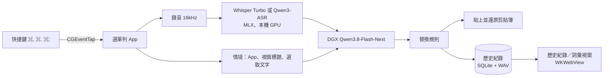

# Voicetype

在 macOS 本機使用的語音輸入工具。按快捷鍵說話，語音在本機轉成文字，交給 DGX 上的 LLM 整理，最後自動貼到目前使用中的 App。

## 功能

| 功能 | 怎麼用 |
|---|---|
| 清理 | **⌘,** 輕量清理：去除贅字、補標點、轉為繁體中文，不改寫語意 |
| 整理 | **⌘.** 修正語序；超過 3 個重點時改成條列 |
| 編輯選取的文字 | 先選取文字，按 **⌘;** 說出指令，例如「改正式一點」「翻成英文」，結果會直接取代選取的文字 |
| 兩種按法 | **短按**：按一下開始，再按一下結束<br>**長按**（≥0.4 秒）：按住說話，放開就送出<br>用哪個模式處理，以結束時按的快捷鍵為準；錄音中按 **Esc** 取消 |
| 自我修正 | 說「三點，不對，四點」，只會留下「四點」 |
| 依 App 調整語氣 | 在 Slack、LINE 用口語；在 Mail、Outlook、Gmail 用正式語氣；在終端機或 IDE 不加句號，指令保持原樣 |
| 參考目前畫面 | 把目前的 App 名稱、視窗標題和詞彙表交給 DGX 參考；剪貼簿和輸入框內容預設不送出 |
| 詞彙與替換規則 | 詞彙會同時提供給 Whisper 和 DGX；替換規則（例如「歐提 → OT」）在最後強制套用 |
| 管理介面首頁 | **⌥⌘,** 或選單列 →「打開 Voicetype」：各模式的快捷鍵（點一下按鍵就能重新錄製、可恢復預設）、權限狀態、使用統計、目前的辨識模型；可切換系統／淺色／深色 |
| 歷史紀錄 | 管理介面 →「歷史紀錄」：搜尋、播放錄音、切換 AI 整理後／原文／分段、複製、換模式重新處理、刪除 |
| 詞彙管理 | 選單列 →「詞彙管理…」；也可以在歷史紀錄中選取一段文字直接加入，或請 DGX 從最近的紀錄建議詞彙 |
| 切換辨識模型 | 管理介面 →「設定」：Whisper Large V3 Turbo／Qwen3-ASR 0.6B／Qwen3-ASR 1.7B，點選就切換；第一次使用會自動下載 |
| 錄音浮動視窗 | Classic（波形加狀態列）、Mini（只有波形）、不顯示，三種樣式從選單列切換 |
| 不污染剪貼簿 | 貼上後還原原本的剪貼簿，Raycast、Paste 這類剪貼簿管理器也不會記錄 |
| DGX 失敗時 | 超過逾時時間（預設 10 秒）就改貼辨識原文；編輯模式則不修改原本的文字。在歷史紀錄裡重新處理失敗時，紀錄也不會被改動 |
| 重新貼上 | 選單列 →「重新貼上上一次結果」：把最近一次貼上的文字再貼一次到目前的 App |
| 暫停 | 選單列 →「暫停」：暫時停用所有快捷鍵（按鍵照常傳給其他 App），圖示變成 ⏸，再點一次恢復 |

所有快捷鍵都在管理介面首頁重新錄製。

## 架構



| 檔案 | 職責 |
|---|---|
| `voicetype.py` | 選單列 App：狀態機、按鍵攔截、worker 執行緒 |
| `core.py` | 不涉及 GUI 的純邏輯：設定、快捷鍵判斷、辨識、LLM prompt、語氣規則、替換規則、詞彙建議、錄音 |
| `macos.py` | 系統互動：貼上、讀取選取文字、取得目前的 App 和視窗標題 |
| `history.py` | 歷史紀錄（SQLite + WAV），過期自動刪除 |
| `hud.py` | 錄音浮動視窗（原生 NSView 繪製） |
| `window.py` + `ui/index.html` | 管理介面：首頁、歷史紀錄、詞彙、設定（WKWebView 搭配 JS bridge） |
| `install.sh` | 產生並載入 LaunchAgent |

## 安裝與執行

需求：Apple Silicon Mac、[uv](https://docs.astral.sh/uv/)，以及能連到 DGX 的網路。

```bash
cd ~/voicetype
uv sync
uv run python voicetype.py   # 印出「就緒」後即可使用
```

第一次使用需要允許三項權限：**麥克風**、**輔助使用**、**輸入監控**。缺少「輔助使用」時會跳出系統授權對話框；允許後幾秒內快捷鍵就會生效，不用重開。

手動啟動時會自動打開管理介面；開機自動啟動則不打開，只有第一次啟動或缺權限時例外。

開機自動啟動（路徑依資料夾位置自動產生，放在哪裡都可以）：

```bash
./install.sh             # 安裝並啟動
./install.sh uninstall   # 停止並移除
```

用 LaunchAgent 啟動時，權限是算在 `realpath .venv/bin/python` 這個執行檔上（`install.sh` 會印出路徑），要把它加進「輔助使用」和「輸入監控」。執行紀錄在 `~/Library/Logs/voicetype.log`。

### 快捷鍵沒反應、管理介面打不開

| 狀況 | 原因與處理 |
|---|---|
| 快捷鍵完全沒反應 | 沒有「輔助使用」權限時，系統不讓 Voicetype 攔截按鍵。管理介面首頁會出現紅框提示，按「打開輔助使用設定」把對應的程式打開：從終端機執行就是終端機（Terminal、iTerm、Ghostty…），LaunchAgent 就是上面那個 python。清單裡已經有、卻還是不行時，先用「−」移除再重新加入 |
| 授權了還是沒反應 | 管理介面按「重新啟動 Voicetype」 |
| 選單列看不到 🎙 | MacBook 瀏海會擋住放不下的選單列圖示。重新啟動 Voicetype，缺權限時會自動打開管理介面；或關掉幾個選單列 App |
| 開機後完全沒有啟動 | 舊版 plist 寫死了作者的路徑，在別台電腦上找不到程式。改用 `./install.sh` |
| 會貼上原文、沒有整理 | 連不到 DGX（`llm_url`），預設的 DGX 只在內部網路可用 |


## 資料位置

| 位置 | 內容 |
|---|---|
| `~/.config/voicetype/config.json` | 設定檔。選單列「開啟設定檔」可以直接編輯，改完按「重新載入設定」 |
| `~/.local/share/voicetype/history.db` | 歷史紀錄 |
| `~/.local/share/voicetype/audio/` | 錄音檔，每筆一個 WAV，1 分鐘約 1.9 MB |

## 常用設定

| 欄位 | 預設 | 說明 |
|---|---|---|
| `hotkeys` | ⌘, ⌘. ⌘; ⌥⌘, | 清理、整理、編輯、打開管理介面；建議從管理介面首頁錄製 |
| `asr_model` | `mlx-community/whisper-large-v3-turbo` | 辨識模型，建議從管理介面「設定」切換；也可以填其他 mlx-audio 支援的 repo |
| `hold_threshold` | 0.4 | 按住超過幾秒算長按 |
| `llm_timeout` | 10 | DGX 逾時秒數，選單列可以快速切換 |
| `history_days` | 30 | 歷史紀錄保留天數（啟動時和之後每小時刪除過期紀錄） |
| `hud_style` | `classic` | `classic`／`mini`／`none` |
| `vocabulary`、`replacements` | | 建議從詞彙管理視窗維護 |
| `app_styles` | 郵件、聊天、終端機／IDE | 依 App 套用的語氣規則。`apps` 填 bundle id，可以用 `*` 萬用字元；`title` 填視窗標題的關鍵字 |
| `context` | 兩項都是 `false` | `clipboard`、`input_field` 打開後，會把剪貼簿或輸入框的內容也交給 DGX |
| `prompts` | | 清理、整理、編輯三種模式的 system prompt |
| `min_seconds`、`max_seconds`、`silence_rms` | 0.5／300／0.003 | 錄音太短、太長或幾乎沒聲音時的判斷門檻 |

## 測試

```bash
uv run pytest -q -m "not e2e"   # 不需要外部資源
uv run pytest -q                # 含 E2E：本機 Whisper、真實 DGX、麥克風
```

按鍵攔截、實際貼到其他 App 這兩段需要 GUI 權限，只能手動驗證。

## 已知限制

- Whisper 遇到發音不清楚的英文（例如 TTS 測試音檔）會辨識錯，DGX 也可能把錯字猜成詞彙表裡的詞。發現誤判時，用替換規則修正最直接。
- Whisper 的 prompt 只會讀進最後約 220 個 token。詞彙太多時，前面的詞 Whisper 會看不到，但 DGX 仍然拿得到完整的詞彙表。
- 貼上後固定等 0.3 秒才還原剪貼簿。如果很慢的 App 貼出來是舊內容，要把這個時間調大（`macos.paste`）。
- 錄音時只顯示音量波形，不提供邊講邊出現文字的即時字幕。

更新紀錄見 [CHANGELOG.md](CHANGELOG.md)。
